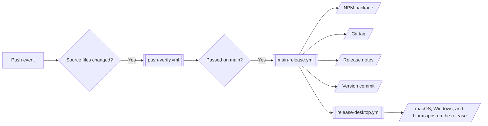

# Contributing

[](https://github.com/semantic-release/semantic-release)

Please read through this guideline before contributing. Every command runs from the repository root.

> [!note]
> [`CLAUDE.md`](../CLAUDE.md) maps the repository, and [`.claude/rules/`](../.claude/rules/) holds the rules for the terminal layout, the workflows, and the documents. Claude Code picks up the `conventional-commit` plugin from [`.claude/settings.json`](../.claude/settings.json).

> [!important]
> Versions are bumped by Semantic Release in [`main-release.yml`](./workflows/main-release.yml). Never edit `version` by hand.

## Prerequisites

Required software for development and CI:

| Tool                           | Version  | Pinned In             |
| ------------------------------ | -------- | --------------------- |
| [Node.js](https://nodejs.org/) | `26.5.0` | [`.nvmrc`](../.nvmrc) |

Run `nvm install` after pulling a change to `.nvmrc`. Users only need the Node.js version in the `engines` field of [`package.json`](../package.json).

## Getting Started

`npm ci` installs the dependencies and, through the `prepare` script, the Husky hooks. Then start the dashboard:

```shell
npm ci
npm start
```

`npm start` reads and writes your real `~/.terminal-sigma/progress.json`. To try a change without touching your journey, point it at a throwaway folder:

```shell
TERMINAL_SIGMA_HOME="$(mktemp -d)" npm start
```

### Desktop App

The desktop app in [`desktop/`](../desktop/) is its own NPM package that bundles `source/` from the root's `node_modules`, so install the root first. Its constraints are in [`desktop/CLAUDE.md`](../desktop/CLAUDE.md):

```shell
npm ci --prefix desktop
npm start --prefix desktop
```

`npm start --prefix desktop` downloads Electron once, then opens the window. `npm run dist --prefix desktop` packages the app for your system into `desktop/release/`.

## Branching Strategy

This repository follows a simple [GitHub Flow](https://docs.github.com/en/get-started/using-github/github-flow), and Semantic Release cuts a release from `main`:

| Branch           | Release | Created From | Merge To |
| ---------------- | ------- | ------------ | -------- |
| `feature-<name>` |         | `main`       | `main`   |
| `main`           | `#.#.#` |              |          |

Commit messages follow [Conventional Commits](https://www.conventionalcommits.org/en/v1.0.0/), and the type decides the release: `feat` publishes a minor version, `fix` a patch, and the rest publish nothing. The CLI and the desktop app share 1 version.

## Commands

[NPM scripts](../package.json) are organized with [ESLint Package.json Conventions](https://eslint.org/docs/latest/contribute/package-json-conventions):

| Command   | Purpose                                                                 |
| --------- | ----------------------------------------------------------------------- |
| `build`   | Clean `build/`, compile TypeScript, and rewrite path aliases            |
| `prepack` | Build before `npm pack` or `npm publish`, so the package is never stale |
| `start`   | Build, then run the dashboard                                           |
| `test`    | Run Prettier, xo, and AVA                                               |

## Git Hooks

Husky runs 2 hooks, and a failure means fixing the code, never skipping the hook:

| Hook         | Runs                                                                      |
| ------------ | ------------------------------------------------------------------------- |
| `commit-msg` | commitlint against Conventional Commits                                   |
| `pre-commit` | lint-staged: Prettier on every staged file, and xo on staged source files |

## Tuning the Character

Every appearance setting is a list of values in [`i18n.ts`](../source/i18n.ts), drawn by [`pixel-art.ts`](../source/pixel-art.ts). The schema in [`progress.ts`](../source/progress.ts) and the form under **Profile** → **Appearance** in [`content.ts`](../source/content.ts) read the same lists, so a new value shows up in both. Render the scenes before and after any change, and look at the PNG sheets it writes to `scenes/`:

```shell
npm run build && node build/tests/render-scenes.js scenes
```

Each setting, its list, and where it is drawn:

| Setting     | List          | Drawn In `pixel-art.ts`                                                         |
| ----------- | ------------- | ------------------------------------------------------------------------------- |
| Facial hair | `facialHairs` | `paintFacialHair` in front, `paintSideHead` in profile                          |
| Glasses     | Yes or no     | `paintHeadFront` and `paintSideHead`                                            |
| Hair color  | `hairColors`  | The colors in `hairKeys`                                                        |
| Hair style  | `hairStyles`  | `paintHairBehind`, `paintFringe`, and `paintSideHead`                           |
| Hat         | `hatStyles`   | `paintHeadFront` and `paintSideHead`; `hatOf` gives the level's cap             |
| Pants       | `pantsStyles` | The colors in `pantsOf`, and `paintLegsFront` and `paintSideLeg`                |
| Shoes       | `shoeStyles`  | The colors and height in `shoeOf`                                               |
| Skin tone   | `skinTones`   | The colors in `skinKeys`                                                        |
| Top         | `topStyles`   | The colors in `topOf`, sleeves in `sleeveOf`, `paintTorsoFront` and `paintSide` |

Without a choice, `outfitOf` dresses the character by work style, and the hat `level` wears the cap that the level hands out.

### Changing How a Value Looks

Each painter draws in pixels around the body: x = 0 is the center column, y grows up from the ground, and the head's rows count up from `b.chin`. A pixel is a 1-character color key from `paletteOf`:

| Keys          | Color                                                 |
| ------------- | ----------------------------------------------------- |
| `C`, `c`, `E` | The theme's main tone, its shade, and its light       |
| `h`, `i`      | Hair, recolored by hair color and greyed by age       |
| `S`, `z`, `T` | The theme's accent tone, its shade, and its light     |
| `s`, `q`      | Skin and its shadow, recolored by skin tone           |
| Any other key | A fixed color, such as `w` for white or `e` for black |

Draw both views: the front for standing still, and the profile for walking and running.

### Adding a Value

A new top, pants, shoe, or hat takes 4 steps:

1. Add the value to its list in `i18n.ts`, and its name under `appearance` in all 3 languages; TypeScript fails until every language has it
2. Draw it in `pixel-art.ts`: a new entry in its color record, or a new `case` in its painters, in front and in profile
3. Raise the count for its setting in the `dresses in the outfit chosen` test in [`pixel-art.test.ts`](../source/tests/pixel-art.test.ts), then run `npm test`
4. Add the value to its `profile.*` row under **Progress File** in [`docs/GUIDE.md`](../docs/GUIDE.md)

A whole new setting, such as gloves, also needs an optional field in `profileShape` in `progress.ts`, a field on `Look` with its default in `defaultLook` and `lookOf`, a `select` in `appearanceFieldsOf` and a line in `appearanceOf` in `content.ts`, and a sheet in [`render-scenes.ts`](../source/tests/render-scenes.ts).

> [!important]
> Never rename or remove a value once released. A `progress.json` that saved it no longer loads, and Terminal-Sigma refuses to start rather than overwrite it.

## Workflows

GitHub Actions workflows for testing and releasing:



Publishing needs the `NPM_ACCESS_TOKEN` repository secret: a granular NPM token with read and write access that bypasses 2FA. NPM caps these at 90 days, so replace it when a release fails with 401 or 404:

```shell
gh secret set NPM_ACCESS_TOKEN --repo SiegeSailor/Terminal-Sigma
```
