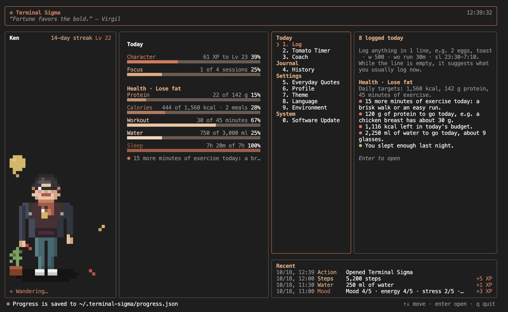
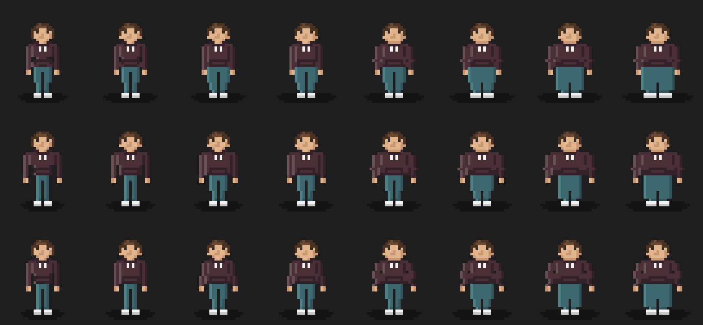
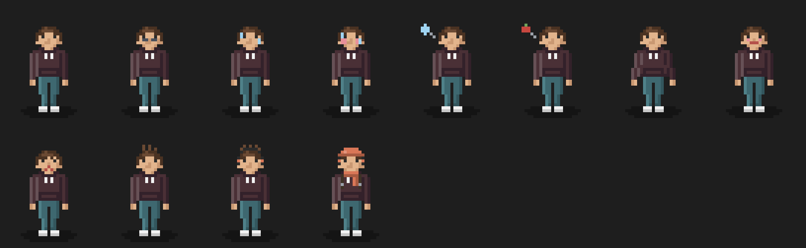
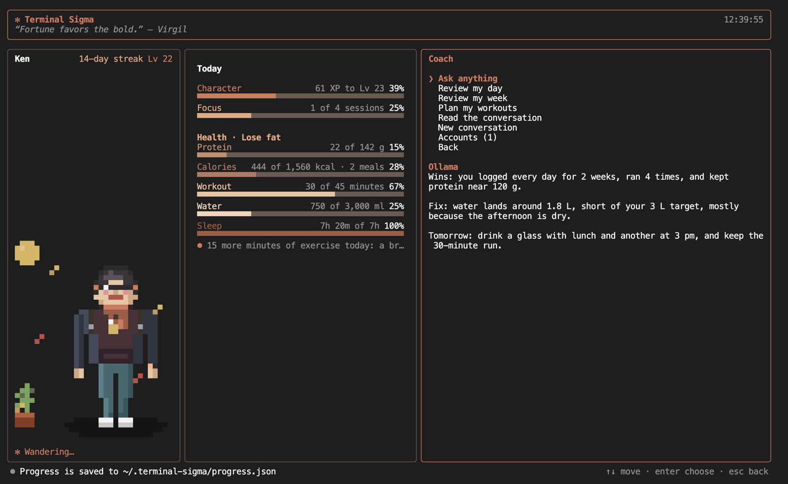
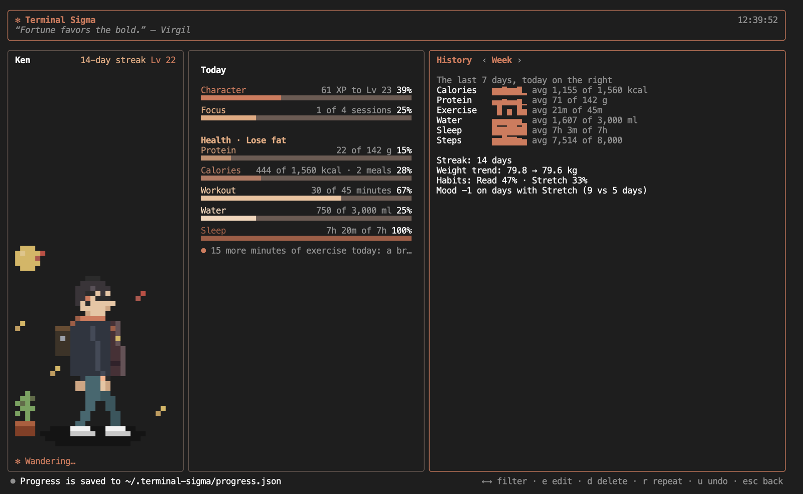
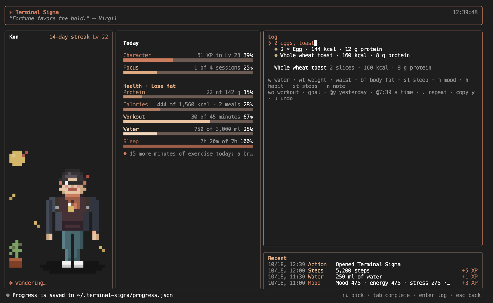

# Terminal-Sigma

[](https://www.npmjs.com/package/@siegesailor/terminal-sigma)
[](https://github.com/SiegeSailor/Terminal-Sigma/releases/latest)
[](https://github.com/SiegeSailor/Terminal-Sigma/actions/workflows/push-verify.yml)
[](https://github.com/SiegeSailor/Terminal-Sigma/actions/workflows/main-release.yml)
[](https://github.com/SiegeSailor/Terminal-Sigma/actions/workflows/release-desktop.yml)

Terminal-Sigma is a game-style dashboard for your self-development that stays open in a terminal tab or in its own desktop window. You log your day in 1 line, and a pixel-art version of you grows with it: it looks like you, levels up with what you do, and shows how today is going. It works offline, keeps your data on your computer, and speaks English, Traditional Chinese, and Korean.



## Features

Your character is always on screen, and the menu opens everything else with a number key.

### Character

Your character is a pixel-art you that wanders its own little room. It follows every detail of your profile: a fuller body every 2 points of body fat, muscle from your strength work, your skin tone, hair, glasses, and beard, and hair that greys with age. It earns a new piece of gear at each level up to 9, and it wears your day on its face, with tired eyes after a short night, a flush after a hard run, and a thought bubble when you are behind on water or due a meal. The sky follows the time of day, and the season brings petals, leaves, or snow.





### Coach

The Coach is an optional AI that reviews your day or week, plans your workouts for the next 7 days, estimates the calories of a food it does not know, and answers questions about training, food, and sleep. It uses your own accounts: OpenAI, Claude, Gemini, Grok, or any OpenAI-compatible server, such as [Ollama](https://ollama.com/), which runs free and offline. When one account fails or hits a limit, the next one picks up the same conversation. The Coach stays off until you add an account, and it gives general guidance, not medical advice.



### History

History lists everything you logged, newest first, filtered by kind, and lets you edit, delete, or repeat any entry. Its Week tab shows the last 7 days against your targets, along with your streak, your weight trend, how strong your habits are, and what goes with a better mood.



### Log

Log takes 1 line for anything you want to track, and shows what it understood before you press Enter:

| You Type        | It Logs                                                     |
| --------------- | ----------------------------------------------------------- |
| `2 eggs, toast` | A meal, matched against your own meals and 155 common foods |
| `m 4 #work`     | Your mood, from 1 to 5, with a tag                          |
| `sl 23:30-7:10` | Last night's sleep                                          |
| `w 500`         | 500 ml of water                                             |
| `wo run 30m`    | A 30-minute run                                             |

Foods work in all 3 languages, such as `牛肉麵` or `계란 2개`, and while the line is empty, Log suggests what you usually log at this hour. Every entry earns experience toward your next level.



### And More

A few smaller features round out the day:

| Feature         | What It Does                                                                          |
| --------------- | ------------------------------------------------------------------------------------- |
| Environment     | Every setting and API key, edited from the menu                                       |
| Everyday Quotes | An inspiring quote that refreshes on your schedule                                    |
| Themes          | 5 color tones for the dashboard and your character                                    |
| Tomato Timer    | A Pomodoro timer, 25 minutes of focus and then a 5-minute break, against a daily goal |

## Installation

Terminal-Sigma comes as a CLI on NPM and as a desktop app on every GitHub release. Both read and write the same data, so you can switch between them.

### CLI

The CLI needs [Node.js](https://nodejs.org/) `>= 22`. Install it globally, then start it and leave it open in a terminal tab:

```shell
npm install --global @siegesailor/terminal-sigma
siegesailor-terminal-sigma --name "Ken"
```

On the first run, it asks for your language.

### Desktop

Download the file for your system from the [latest release](https://github.com/SiegeSailor/Terminal-Sigma/releases/latest); the desktop app needs no Node.js:

| System                | File                                             | First Launch                                                        |
| --------------------- | ------------------------------------------------ | ------------------------------------------------------------------- |
| Linux                 | `Terminal-Sigma-<version>-linux-x86_64.AppImage` | Run `chmod +x` on the file, then open it                            |
| macOS (Apple Silicon) | `Terminal-Sigma-<version>-mac-arm64.dmg`         | Drag the app to Applications, then see the note below               |
| macOS (Intel)         | `Terminal-Sigma-<version>-mac-x64.dmg`           | Drag the app to Applications, then see the note below               |
| Windows               | `Terminal-Sigma-<version>-win-x64.exe`           | Choose **More info**, then **Run anyway** in the SmartScreen prompt |

> [!note]
> The apps are not signed by Apple or Microsoft yet. If macOS says the app "is damaged and can't be opened", it only means the download is quarantined; clear the flag once:
>
> ```shell
> xattr -dr com.apple.quarantine "/Applications/Terminal Sigma.app"
> ```

The desktop app sends a notification when a focus or break ends, and it updates itself from **Software Update** in the menu.

## Your Data

Everything Terminal-Sigma knows about you lives on your computer, in `~/.terminal-sigma` by default:

| File            | Holds                                                     |
| --------------- | --------------------------------------------------------- |
| `coach.json`    | Your conversations with the Coach, readable only by you   |
| `config.json`   | The settings and API keys you saved, readable only by you |
| `progress.json` | Your profile and everything you logged, in readable JSON  |

Your data never leaves your computer unless you add a Coach account, set an API key for quotes, or turn on tracing with [Langfuse](https://langfuse.com/).

## Guide

Every key, option, environment variable, health target, and file format is in the [Guide](./docs/GUIDE.md).

## Contributing

See [`CONTRIBUTING.md`](./.github/CONTRIBUTING.md) to work on Terminal-Sigma, and [`SECURITY.md`](./.github/SECURITY.md) to report a vulnerability.

## License

[MIT](./LICENSE.md)

Bundled nutrition and exercise data keep their own licenses, listed in [`DATA-LICENSES.md`](./DATA-LICENSES.md).
